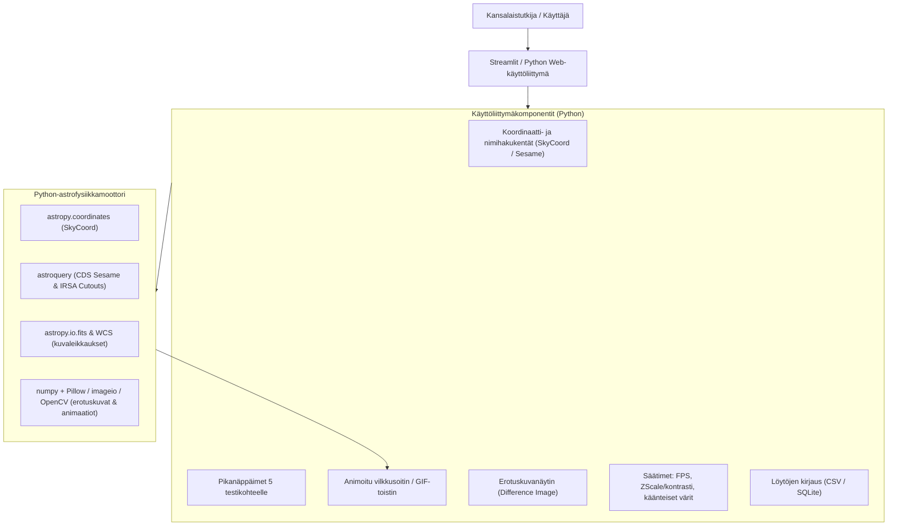
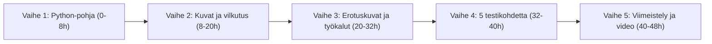

# PlanetXSPHEREx: Kansalaistieteen työkalu taivaankappaleiden liikkeen ja muuttuvuuden havaitsemiseen
## Python-pohjainen projektisuunnitelma ja tekninen arkkitehtuuri (4 hengen tiimi)

---

### 1. Tiivistelmä ja haasteen tavoitteet

NASAn **SPHEREx**-missio (Spectro-Photometer for the History of the Universe, Epoch of Reionization, and Ices Explorer) kartoittaa koko taivaan kerran kuudessa kuukaudessa **102 lähi-infrapunan aallonpituuskaistalla** (0,75–5,0 µm).

**Haaste:** Rakentaa julkinen, helppokäyttöinen **Python-pohjainen verkkosovellus**, jolla kansalaistutkijat ja tähtitieteilijät voivat:
1. Syöttää taivaankoordinaatit (rektaskensio RA ja deklinaatio Dec joko asteina tai aikamuodossa `hh:mm:ss` / `dd:mm:ss`) tai etsiä kohteita suoraan nimellä.
2. Tarkastella kyseisen taivaankohdan kuvia eri havaintojaksoilta (epookeilta) animaationa / vilkkukomparaattorina ("blink comparator").
3. Havaita nopeasti liikkuvia kohteita (suuren ominaisliikkeen tähdet, ruskeat kääpiöt, asteroidit, komeetat, mahdollinen Planeetta Yhdeksän / Planet X) sekä kirkkauttaan muuttavia kohteita (muuttuvat tähdet, supernovat).
4. Testata ja validoida työkalun toimivuus viidellä pakollisella vertailukohteella:
   - **Barnardin tähti** (suurin tunnettu ominaisliike: $\sim 10,3''/\text{vuosi}$)
   - **Epsilon Indi B** (läheinen ruskeiden kääpiöiden kaksoisjärjestelmä)
   - **WISE 0855** (kylmin ja erittäin nopeasti liikkuva ruskea kääpiö: RA `08h55m10.831s`, Dec `-7d14m42.53s`)
   - **RW Aurigae** (purkautuva T Tauri -muuttuja)
   - **R Draconis** (Mira-tyypin sykkivä jättiläistähti)

---

### 2. Järjestelmäarkkitehtuuri ja Python-teknologiapino

Sovelluksen käyttöliittymä toteutetaan puhtaasti Pythonilla (ensisijaisena suosituksena **Streamlit**, joka mahdollistaa nopean kehityksen, helpon jakamisen ja ilmaisen pilvijulkaisun suoraan GitHubista, tai vaihtoehtoisesti **FastAPI + kevyt HTML5/JS-näkymä**).



#### Keskeiset Python-kirjastot:
- **`streamlit`**: Nopea, moderni ja interaktiivinen web-käyttöliittymä liukusäätimillä, välilehdillä ja painikkeilla.
- **`astropy`**: 
  - `astropy.coordinates.SkyCoord`: joustava koordinaattien tulkinta (asteet, sexagesimaali, J2000).
  - `astropy.io.fits`: tieteellisten FITS-kuvien lukeminen ja WCS-koordinaattimuunnokset.
  - `astropy.visualization.ZScaleInterval` / `AsinhStretch`: tähtitieteellinen optimaalinen kontrastin venytys.
- **`astroquery`**:
  - `astroquery.simbad` & `astroquery.ipac.irsa`: kohteiden nouto nimen perusteella ja kuvaleikkausten haku.
- **`numpy`**: erittäin nopea matriisilaskenta erotuskuville ($\Delta I = I_2 - I_1$).
- **`Pillow`** / **`imageio`**: animoitujen GIFien ja videoiden luominen reaaliajassa vilkuttamista ja lataamista varten.

---

### 3. Tiimin roolit ja työnjako (4 hengen Python-tiimi)

| Rooli | Päävastuut | Keskeiset tuotokset |
| :--- | :--- | :--- |
| **Henkilö 1: Käyttöliittymä & UI/UX (Python/Streamlit)** | Pääsivun asettelu, sivupalkki, toistosäätimet (nopeus, loop/bounce), esiasetuspainikkeet 5 testikohteelle, tumma avaruusteema. | - `app.py` (Streamlit-pääsovellus)<br>- Interaktiiviset ohjaimet ja tilanhallinta<br>- Responsiivinen layout ja visuaalinen ilme |
| **Henkilö 2: Astrofysiikka & Koordinaatit (`astropy`)** | Koordinaattien jäsennys (RA/Dec), automaattinen nimenhaku (Sesame/SIMBAD), WCS-muunnokset (pikselit $\leftrightarrow$ taivaankoordinaatit). | - `astro_utils.py` (SkyCoord-jäsennin)<br>- Nimipalvelun integrointi<br>- Tähtäinristikon ja mittakaavan ($10''$) laskenta |
| **Henkilö 3: Dataputki, Kuvankäsittely & Vienti (`numpy`, `fits`)** | FITS-kuvien lataus (IRSA/SPHEREx), erotuskuvalaskenta ($\Delta I$), kontrastin venytys (ZScale/MinMax/Log) ja animoitujen GIFien generointi. | - `data_fetcher.py` (kuvaleikkausten nouto)<br>- `image_processing.py` (erotuskuvat & ZScale)<br>- GIF- ja MP4-animaatioiden luontifunktiot |
| **Henkilö 4: Tieteellinen QA, Testikohteet & Pitchaus** | 5 pakollisen testikohteen ajaminen ja kuvien validointi, kansalaistutkijan kenttäoppaan kirjoitus sovellukseen, esitysmateriaalit ja demo-video. | - Valmiiksi testatut koordinaatit ja esimerkit<br>- "Field Guide" -ohjesivu sovellukseen<br>- 3 minuutin esittelyvideo ja esityskalvot<br>- Space Apps -dokumentaatio ja `README.md` |

---

### 4. Vaiheittainen etenemissuunnitelma (48 h hackathon)



#### Vaihe 1: Python-ympäristö ja perusrunko (Tunnit 0–8)
- [ ] Luodaan virtuaaliympäristö (`python3 -m venv venv`) ja `requirements.txt`.
- [ ] Pystytetään perus-Streamlit-sovellus (`streamlit run app.py`).
- [ ] Kirjoitetaan koordinaattimuunnin `SkyCoord`-kirjastolla:
  - Tunnistaa automaattisesti syötteet: `133.795, -7.245` tai `08h55m10.831s -07d14m42.53s`.
- [ ] Integroidaan kohteen nimenhaku (esim. kirjoittamalla `"Barnard's Star"` kenttä täyttää oikeat koordinaatit automaattisesti).
- [ ] Lisätään sivupalkkiin 5 testikohteen pikanäppäimet.

#### Vaihe 2: Kuvien nouto ja vilkkukomparaattori (Tunnit 8–20)
- [ ] Luodaan kuvahaun moduuli (`data_fetcher.py`):
  - Haetaan useamman epookin infrapunaleikkaukset (esim. WISE/unWISE- tai SPHEREx-arkistosta) annetuilla koordinaateilla.
- [ ] Luodaan vilkkukomparaattori:
  - Generoidaan moniepookkisista kuvista sulava animoitu GIF tai HTML5-videosilmukka suoraan Pythonissa (`imageio`/`Pillow`).
  - Lisätään toistonopeuden säädin (1–15 fps) ja kuva kerrallaan tarkastelu.

#### Vaihe 3: Kuvankäsittely ja kansalaistutkijan työkalut (Tunnit 20–32)
- [ ] **Erotuskuvat (Difference Imaging):**
  - Lasketaan NumPyssä $\text{Epookki}_2 - \text{Epookki}_1$.
  - Liikkuva kohde tai muuttuva tähti näkyy selvänä mustavalkoisena dipolina!
- [ ] **Tähtitieteellinen kontrastin venytys:**
  - `astropy.visualization.ZScaleInterval` ja `MinMaxInterval`.
  - Negatiivitila (värien kääntö).
- [ ] **Löydön kirjaus ja raportointi:**
  - Käyttäjä voi klikata tai syöttää huomaamansa kohteen koordinaatit, valita tyypin (*Liikkuva kohde*, *Muuttuva tähti*, *Häiriö*) ja ladata raportin (CSV + GIF).

#### Vaihe 4: Viiden pakollisen testikohteen validointi (Tunnit 32–40)
- [ ] **Barnardin tähti:** Todennetaan raju ominaisliike ($>10''/\text{vuosi}$).
- [ ] **WISE 0855:** Todennetaan erittäin himmeän ja kylmän ruskean kääpiön liike.
- [ ] **Epsilon Indi B:** Havaitaan päätähden ohella liikkuva ruskea kääpiöpari.
- [ ] **RW Aurigae:** Todennetaan dramaattinen kirkkauden himmeneminen.
- [ ] **R Draconis:** Todennetaan Mira-tähden valtava sykkimisjakso.

#### Vaihe 5: Viimeistely, ohjeet ja pitchaus (Tunnit 40–48)
- [ ] Lisätään sovellukseen interaktiivinen **"Kenttäopas" (Field Guide)** esimerkkikuvineen.
- [ ] Varmistetaan sovelluksen suorituskyky ja välimuistitus (`@st.cache_data`).
- [ ] Nauhoitetaan 3 minuutin esittelyvideo.
- [ ] Viimeistellään `README.md` ja julkaistaan sovellus ilmaiseksi (esim. Streamlit Community Cloud tai Hugging Face Spaces).

---

### 5. Testikohteiden kalibrointitaulukko

| Kohde | RA (J2000) | Dec (J2000) | Tyyppi / Ilmiö | Mitä vilkutuksessa näkyy |
| :--- | :--- | :--- | :--- | :--- |
| **Barnardin tähti** | `17h 57m 48.5s` | `+04° 41′ 36″` | Suuren ominaisliikkeen punainen kääpiö | Tähti hyppää selvästi eteenpäin taustatähtien pysyessä paikallaan |
| **WISE 0855-0714** | `08h 55m 10.83s` | `-07° 14′ 42.5″` | Kylmin tunnettu aliruskea kääpiö | Pieni himmeä piste liikkuu taustataivaan halki |
| **Epsilon Indi B** | `22h 04m 10.5s` | `-56° 46′ 58″` | Ruskea kääpiöpari ($T1 + T6$) | Päätähden mukana kulkeva erillinen himmeä seuralainen |
| **RW Aurigae** | `05h 07m 49.5s` | `+30° 24′ 05″` | Purkautuva T Tauri -muuttuja | Tähden kirkkaus romahtaa ja palaa takaisin pölypilvien takia |
| **R Draconis** | `16h 32m 40.2s` | `+66° 45′ 18″` | Mira-tyypin sykkivä jättiläinen | Tähti kasvaa ja himmenee valtavasti (mag 6,7 $\leftrightarrow$ 13,2) |

---

### 6. Aloitus: Suositeltu tiedostorakenne ja `requirements.txt`

```text
PlanetXSPHEREx/
├── app.py                 # Streamlit-pääsovellus ja käyttöliittymä
├── astro_utils.py         # Koordinaattimuunnokset ja nimihaku (Astropy, Sesame)
├── data_fetcher.py        # Kuvaleikkausten nouto ja välimuisti
├── image_processing.py    # Erotuskuvat, ZScale-venytys, animoidun GIFin teko
├── targets.py             # Esitallennetut testikohteet koordinaatteineen
├── PLAN.md                # Tämä projektisuunnitelma
├── requirements.txt       # Python-riippuvuudet
└── README.md              # Projektin esittely ja ohjeet
```

**Alustava `requirements.txt`:**
```text
streamlit>=1.35.0
astropy>=6.0.0
astroquery>=0.4.7
numpy>=1.24.0
Pillow>=10.0.0
imageio>=2.30.0
matplotlib>=3.8.0
requests>=2.31.0
```
