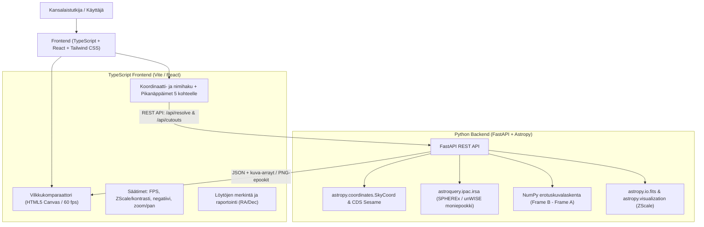
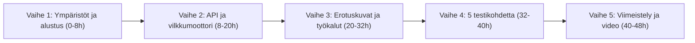

# PlanetXSPHEREx: Kansalaistieteen työkalu taivaankappaleiden liikkeen ja muuttuvuuden havaitsemiseen
## Fullstack-projektisuunnitelma (TypeScript Frontend + Python Backend) – 4 hengen tiimi

---

### 1. Tiivistelmä ja haasteen tavoitteet

NASAn **SPHEREx**-missio (Spectro-Photometer for the History of the Universe, Epoch of Reionization, and Ices Explorer) kartoittaa koko taivaan kerran kuudessa kuukaudessa **102 lähi-infrapunan aallonpituuskaistalla** (0,75–5,0 µm).

**Haaste:** Rakentaa moderni ja suorituskykyinen julkinen verkkotyökalu (**TypeScript/React-frontend + Python/FastAPI-backend**), jolla kansalaistutkijat ja tähtitieteilijät voivat:
1. Syöttää taivaankoordinaatit (rektaskensio RA ja deklinaatio Dec joko asteina tai aikamuodossa `hh:mm:ss` / `dd:mm:ss`) tai etsiä kohteita suoraan nimellä.
2. Tarkastella kyseisen taivaankohdan kuvia eri havaintojaksoilta (epookeilta) reaaliaikaisena vilkkukomparaattorina ("blink comparator").
3. Havaita nopeasti liikkuvia kohteita (suuren ominaisliikkeen tähdet, ruskeat kääpiöt, asteroidit, komeetat, mahdollinen Planet X) sekä kirkkauttaan muuttavia kohteita (muuttuvat tähdet, supernovat).
4. Testata ja validoida työkalun toimivuus viidellä pakollisella vertailukohteella:
   - **Barnardin tähti** (suurin tunnettu ominaisliike: $\sim 10,3''/\text{vuosi}$)
   - **Epsilon Indi B** (läheinen ruskeiden kääpiöiden kaksoisjärjestelmä)
   - **WISE 0855** (kylmin ja erittäin nopeasti liikkuva ruskea kääpiö: RA `08h55m10.831s`, Dec `-7d14m42.53s`)
   - **RW Aurigae** (purkautuva T Tauri -muuttuja)
   - **R Draconis** (Mira-tyypin sykkivä jättiläistähti)

---

### 2. Järjestelmäarkkitehtuuri

Yhdistetään moderni **TypeScript-frontend** (sulava 60 fps Canvas-animaatio, responsiivinen UI) ja **Python-backend** (tähtitieteen standardikirjastot Astropy ja Astroquery).



---

### 3. Tiimin roolit ja työnjako (4 hengen tiimi)

| Rooli | Päävastuut | Keskeiset teknologiat ja tuotokset |
| :--- | :--- | :--- |
| **Henkilö 1: Frontend & Visualisointi (TypeScript Lead)** | HTML5 Canvas -vilkkukomparaattori, toistonopeuden säätö (1–15 fps), loop- ja bounce-toistotilat, zoom/pan-toiminnot, tumma NASA-teema, GIF-vienti. | - `BlinkViewer.tsx` (Canvas-moottori)<br>- `PlaybackControls.tsx`<br>- `client-side GIF/WebM-export` |
| **Henkilö 2: Frontend & Käyttäjäkokemus (TypeScript UI Lead)** | Hakukenttä (koordinaattien validointi + nimenhaku), 5 testikohteen pikavalikko, löytöjen merkintätyökalu suoraan kuvalle, kansalaistutkijan kenttäopas (Field Guide). | - `CoordinateSearch.tsx`<br>- `TargetDrawer.tsx` (5 testikohdetta)<br>- `FieldGuideModal.tsx`<br>- `CandidateReportForm.tsx` |
| **Henkilö 3: Backend & Astrofysiikka (Python Lead)** | FastAPI-palvelin, koordinaattimuunnokset (`astropy.coordinates.SkyCoord`), CDS Sesame -nimipalvelu, IRSA/SPHEREx-leikkausten nouto ja välimuisti. | - `main.py` (FastAPI endpoints: `/api/resolve`, `/api/cutouts`)<br>- `astro_service.py` (`SkyCoord`, Sesame)<br>- `data_fetcher.py` (IRSA / unWISE) |
| **Henkilö 4: Backend-kuvankäsittely, QA & Pitchaus (Python & Science Lead)** | Reaaliaikainen erotuskuvalaskenta NumPyssä ($\Delta I$), ZScale-kontrastisäädöt (`astropy.visualization`), 5 testikohteen validointi, esittelyvideo ja pitchaus-materiaali. | - `image_service.py` (erotuskuvat, ZScale)<br>- Testiaineistot 5 pakolliselle kohteelle<br>- 3 min esittelyvideo ja esityskalvot<br>- Space Apps -dokumentaatio |

---

### 4. API-rajapintasopimus (Frontend $\leftrightarrow$ Backend)

1. **`GET /api/targets`**
   - Palauttaa 5 esitallennetun testikohteen tiedot ja koordinaatit (Barnardin tähti, WISE 0855, Epsilon Indi B, RW Aurigae, R Draconis).
2. **`GET /api/resolve?query={name_or_coords}`**
   - Tunnistaa annetun nimen (esim. `"Barnard's Star"`) tai raakakoordinaatit (`08h55m10.831s -07d14m42.53s`).
   - Palauttaa normalisoidun JSONin: `{ ra_deg: 133.795, dec_deg: -7.245, display_name: "WISE 0855" }`.
3. **`GET /api/cutouts?ra={deg}&dec={deg}&fov_arcmin={fov}`**
   - Hakee useamman epookin kuvat (esim. SPHEREx ja unWISE moniepookki).
   - Palauttaa kuvaepookit aikajärjestyksessä sekä valmiiksi lasketun erotuskuvan (difference image).
4. **`POST /api/report`**
   - Tallentaa kansalaistutkijan tekemän löydön koordinaatteineen ja luokituksineen.

---

### 5. Vaiheittainen etenemissuunnitelma (48 h hackathon)



#### Vaihe 1: Alustus ja perusrakenteet (Tunnit 0–8)
- [ ] Luodaan kansiot `frontend/` (Vite + React + TypeScript + Tailwind) ja `backend/` (FastAPI + Python).
- [ ] Backend: `SkyCoord`-tulkki ja Sesame-nimipalvelin.
- [ ] Frontend: Sivupohja tummalla avaruusteemalla, hakupalkki ja 5 testikohteen napit.
- [ ] Varmistetaan kommunikaatio selaimen ja Python-rajapinnan välillä (CORS ja `/api/health`).

#### Vaihe 2: Kuvatiedonsiirto ja Canvas-vilkutus (Tunnit 8–20)
- [ ] Backend: Moniepookkisen kuvahaun toteutus (SPHEREx-mock ja unWISE IRSA -arkistot).
- [ ] Frontend: HTML5 Canvas -vilkkukomparaattori:
  - Toisto/pausaus, nopeudensäädin (1–15 fps), kuva kerrallaan siirtyminen.
  - Toistotilat: Jatkuva silmukka ja edestakainen bounce-animaatio.
- [ ] Tähtäinristikko ja kaarisekuntien mittakaavajana kuvan kulmassa.

#### Vaihe 3: Kuvankäsittely ja kansalaistutkijan työkalut (Tunnit 20–32)
- [ ] **Erotuskuvat (Difference Imaging):** Laskenta backendissä NumPyllä ($\Delta I = I_2 - I_1$) ja esitys suoraan frontendin soittimessa.
- [ ] **Kontrastisäädöt:** ZScale-venytys, logaritminen skaalaus ja negatiivitila (värien kääntö).
- [ ] **Löytöjen merkintä:** Käyttäjä klikkaa kuvaa $\rightarrow$ lasketaan pikselistä tarkat $(RA, Dec)$ -koordinaatit ja avataan raportointilomake.
- [ ] **Animaation vienti:** Selaimessa ladattava animoitu GIF.

#### Vaihe 4: Viiden pakollisen testikohteen validointi (Tunnit 32–40)
- [ ] **Barnardin tähti:** Todennetaan $>10''/\text{vuosi}$ siirtymä.
- [ ] **WISE 0855:** Todennetaan kylmän ruskean kääpiön liike taustataivaan halki.
- [ ] **Epsilon Indi B:** Erotetaan päätähden mukana liikkuva ruskea kääpiöpari.
- [ ] **RW Aurigae:** Todennetaan suuret kirkkauden pudotukset (pölypilvet).
- [ ] **R Draconis:** Todennetaan Mira-tähden sykkiminen (mag 6,7 $\leftrightarrow$ 13,2).

#### Vaihe 5: Viimeistely, ohjeet ja pitchaus (Tunnit 40–48)
- [ ] Interaktiivinen **"Kenttäopas / Field Guide"** -ohjemodaali käyttöliittymään.
- [ ] 3 minuutin esittelyvideon käsikirjoitus ja nauhoitus.
- [ ] `README.md`-tiedoston ja NASA Space Apps -projektisivun viimeistely.
- [ ] Julkaisu: Frontend Vercelille/GitHub Pagesille ja Python-backend esim. Render / Railway / Fly.io.

---

### 6. Projektin suositeltu kansiorakenne

```text
PlanetXSPHEREx/
├── PLAN.md                     # Tämä projektisuunnitelma
├── README.md                   # Projektin yleiskuvaus ja käynnistysohjeet
│
├── frontend/                   # TypeScript + React + Vite + Tailwind
│   ├── package.json
│   ├── vite.config.ts
│   ├── tsconfig.json
│   └── src/
│       ├── App.tsx
│       ├── components/
│       │   ├── BlinkViewer.tsx        # Canvas-vilkkumoottori
│       │   ├── CoordinateSearch.tsx   # Haku ja validointi
│       │   ├── PlaybackControls.tsx   # FPS, play/pause, bounce
│       │   ├── TargetDrawer.tsx       # 5 pakollista testikohdetta
│       │   ├── FieldGuideModal.tsx    # Ohje kansalaistutkijoille
│       │   └── CandidateModal.tsx     # Löytöjen merkintälomake
│       ├── services/api.ts            # Kutsut Python-backendiin
│       └── types.ts                   # TypeScript-rajapinnat
│
└── backend/                    # Python + FastAPI + Astropy
    ├── requirements.txt
    ├── main.py                 # FastAPI REST API -reitit
    ├── config.py
    └── services/
        ├── astro_service.py    # SkyCoord & Sesame -nimipalvelu
        ├── data_fetcher.py     # IRSA/unWISE & SPHEREx -kuvaleikkaukset
        ├── image_service.py    # Erotuskuvat (NumPy) & ZScale-venytys
        └── targets.py          # 5 pakollisen testikohteen data
```

#### Alustavat riippuvuudet:
- **`backend/requirements.txt`**:
  ```text
  fastapi>=0.111.0
  uvicorn[standard]>=0.30.0
  astropy>=6.0.0
  astroquery>=0.4.7
  numpy>=1.24.0
  Pillow>=10.0.0
  requests>=2.31.0
  pydantic>=2.7.0
  python-multipart>=0.0.9
  ```
- **`frontend/package.json`** keskeiset paketit:
  `react`, `react-dom`, `lucide-react`, `tailwindcss`, `axios`, `gifshot`
