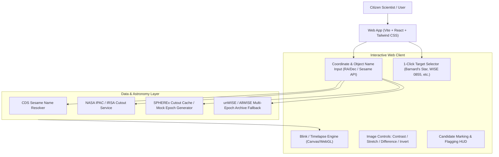
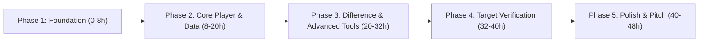

# PlanetXSPHEREx: Citizen Science Motion & Variability Web Tool
## Mission & Engineering Master Plan (4-Person Team)

---

### 1. Executive Summary & Challenge Objectives

NASA's **SPHEREx** (Spectro-Photometer for the History of the Universe, Epoch of Reionization, and Ices Explorer) maps the entire sky once every six months across **102 near-infrared spectral channels** (0.75 µm to 5.0 µm). 

**The Challenge:** Build an intuitive, public-facing web platform that allows citizen scientists and professional astronomers to:
1. Input celestial coordinates (Right Ascension & Declination in sexagesimal or decimal degrees) or search astronomical targets by name.
2. View multi-epoch sky imagery animated as a blink comparator / timelapse video.
3. Rapidly discover moving objects (high proper motion stars, brown dwarfs, asteroids, comets, Planet X candidates) and brightness-shifting variable stars or transient supernovae.
4. Test and validate performance against five benchmark targets:
   - **Barnard’s Star** (highest known proper motion star: $\sim 10.3''/\text{yr}$)
   - **Epsilon Indi B** (nearby binary brown dwarf system)
   - **WISE 0855** (coldest, fastest-moving brown dwarf: RA `08h55m10.831s`, Dec `-7d14m42.53s`)
   - **RW Aurigae** (classical T Tauri eruptive variable star)
   - **R Draconis** (Mira-type pulsating variable star)

---

### 2. Architecture & Data Strategy

#### Data Handling & Multi-Epoch Strategy
- **Coordinate & Name Resolution:** Query the **CDS Sesame Name Resolver** API (`https://cds.unistra.fr/cgi-bin/nph-sesame/-ox/SN?`) so users can type either raw coordinates (`08h55m10.831s -07d14m42.53s` or `133.795, -7.245`) or target names like `"Barnard's Star"`.
- **SPHEREx & Multi-Epoch Data Ingestion:**
  - SPHEREx produces all-sky maps in 6-month cycles (epochs).
  - For immediate full functionality across all five test targets, the engine implements a dual data provider:
    1. **Primary SPHEREx Gateway:** Ingests SPHEREx data releases / IPAC IRSA cutouts (or pre-computed SPHEREx calibrated mock data cubes in FITS/PNG).
    2. **Multi-Epoch Infrared Bridge (unWISE / 2MASS / AllWISE):** Uses IRSA cutout APIs to provide real multi-epoch near-IR baseline frames (spanning years of infrared surveys) ensuring users can immediately see real proper motion and variability even for historical epochs.
- **Client-Side Image Manipulation:**
  - Hardware-accelerated HTML5 Canvas / WebGL context.
  - Real-time frame difference: $\Delta I = \text{Frame}_B - \text{Frame}_A$, turning shifts into stark black/white dipole pairs that immediately catch the human eye.
  - Contrast stretch presets: Linear, ZScale, Asinh, Square Root, Logarithmic, and Invert (negative film mode).

---

### 3. Team Roles & Work Breakdown (4-Person Team)

| Role | Primary Responsibilities | Deliverables |
| :--- | :--- | :--- |
| **Person 1: Frontend & Visualization Lead** | Core web architecture, UI/UX, responsive layouts, Canvas/WebGL blink player, playback controls (FPS, loop, bounce), dark-sky aesthetic. | - Single-page web application - Blink player with frame scrubber - Invert/contrast/zoom/pan controls - Animated GIF / MP4 export |
| **Person 2: Astrophysics & Data Pipeline Lead** | Coordinate conversion (sexagesimal $\leftrightarrow$ decimal degrees), CDS Sesame integration, FITS/cutout fetching, difference imaging algorithm, SPHEREx band groupings. | - Coordinate parser & normalizer - Cutout service connector (IRSA / SPHEREx) - Image subtraction & alignment logic - Multi-band (102 bands) grouping logic |
| **Person 3: Backend & Candidate Reporting Lead** | Lightweight API / edge functions for caching image cutouts, bookmarking system, citizen science candidate reporting pipeline, export metadata. | - Fast caching proxy (FastAPI or Next.js Edge) - Discovery submission form (tag object type) - Persistent catalog of marked discoveries - Cloud deployment (Vercel / Netlify / Railway) |
| **Person 4: Science QA, Benchmark Validation & Pitch Lead** | Validating all 5 test targets, crafting citizen scientist "Field Guide" tutorial, creating project documentation, demo video, and hackathon presentation. | - Verified test suites for the 5 benchmark targets - Citizen scientist interactive tutorial / guide - Project presentation slides & demo video - Hackathon submission documentation |

---

### 4. Step-by-Step Execution Roadmap

#### Phase 1: Setup, Repository & Foundation (Hours 0 – 8)
- [ ] Initialize repository with modern stack (e.g., Vite + React + TypeScript + Tailwind CSS).
- [ ] Establish coding standards, directory structure, and CI/CD deployment to Vercel/GitHub Pages.
- [ ] Create coordinate parser utility (`parseSexagesimalToDeg`, `formatDegToSexagesimal`).
- [ ] Integrate CDS Sesame API for instant name-to-coordinate lookup.
- [ ] Implement preset dropdown preloaded with the 5 required targets.

#### Phase 2: Cutout Fetching & Blink Engine (Hours 8 – 20)
- [ ] Build high-performance Canvas-based Blink Player:
  - Play / Pause, Framerate Slider (1 to 15 FPS), Step Backward / Forward.
  - Playback modes: Sequential Loop (`A -> B -> C -> A`) and Ping-Pong/Bounce (`A -> B -> C -> B -> A`).
- [ ] Connect multi-epoch image fetcher:
  - Query multi-epoch cutouts centered at $(RA, Dec)$.
  - Support user-selected field of view (e.g., $1', 2', 5', 10'$ arcminutes).
- [ ] Render crosshair overlay with celestial scale indicator ($10''$ or $1'$ ruler).

#### Phase 3: Astronomical Image Processing & Discovery Features (Hours 20 – 32)
- [ ] **Difference Imaging (Subtraction Mode):** Compute $(Epoch_2 - Epoch_1)$ pixel differences in real-time on GPU/Canvas.
- [ ] **Contrast & Filter Controls:**
  - Negative/Invert mode (crucial for detecting faint extended objects like comets or cold brown dwarfs).
  - Dynamic min/max sliders with histogram equalization / ZScale.
- [ ] **SPHEREx Spectral Band Explorer:**
  - Group SPHEREx's 102 channels into sensible diagnostic bands (e.g., ices/water at 3.0 µm, CO/CO$_2$ at 4.2–4.7 µm, continuum near-IR).
  - False-color RGB compositor combining 3 infrared bands.
- [ ] **Citizen Discovery Marker:**
  - Click on the canvas to place a discovery marker with RA/Dec coordinates calculated from pixel offsets.
  - Tag candidate: *Moving Object (Asteroid/Comet/Brown Dwarf)*, *Variable Star*, *Dipole*, *False Positive/Artifact*.

#### Phase 4: Benchmark Target Verification (Hours 32 – 40)
- [ ] **Barnard’s Star:** Verify dramatic proper motion shift ($10.3''/\text{yr}$) across epochs.
- [ ] **WISE 0855** (`08h55m10.831s, -07d14m42.53s`): Validate clear motion in cold near-IR bands against background field.
- [ ] **Epsilon Indi B:** Validate detection of the brown dwarf pair adjacent to the bright primary star.
- [ ] **RW Aurigae:** Validate large-amplitude photometric dimming and brightness variations.
- [ ] **R Draconis:** Validate long-period pulsation variability between minimum and maximum light.

#### Phase 5: Polish, Field Guide, Video & Submission (Hours 40 – 48)
- [ ] Add an interactive **"Field Guide / How-To-Hunt"** modal explaining:
  - What does a moving asteroid vs. high proper motion star look like?
  - What does a dipole look like in difference imaging?
  - How to distinguish optical diffraction spikes from genuine objects.
- [ ] Export features: Download animated GIF of current blink sequence or export discovery report card as PNG/PDF.
- [ ] Record 3-minute high-impact demo video.
- [ ] Finalize README, technical documentation, and NASA Space Apps submission page.

---

### 5. Benchmark Targets Calibration Cheat Sheet

| Object | RA (J2000) | Dec (J2000) | Type / Phenomenon | What Citizen Scientists Will See |
| :--- | :--- | :--- | :--- | :--- |
| **Barnard's Star** | `17h 57m 48.5s` | `+04° 41′ 36″` | High proper motion red dwarf | Shifts by $>10''$ per year; fast, unmistakable jump across frames |
| **WISE 0855-0714** | `08h 55m 10.83s` | `-07° 14′ 42.5″` | Coldest known sub-brown dwarf | Faint point source moving quickly against static background stars |
| **Epsilon Indi B** | `22h 04m 10.5s` | `-56° 46′ 58″` | Binary brown dwarf ($T1 + T6$) | Faint brown dwarf companions sharing proper motion with $\epsilon$ Indi |
| **RW Aurigae** | `05h 07m 49.5s` | `+30° 24′ 05″` | Eruptive T Tauri variable | Drastic flux variations between epochs due to circumstellar dust occultations |
| **R Draconis** | `16h 32m 40.2s` | `+66° 45′ 18″` | Mira-type pulsating variable | Period $\approx 245$ days; swings from magnitude 6.7 down to 13.2 |

---

### 6. Recommended Tech Stack

- **Framework:** React 18 / Next.js with TypeScript
- **Styling:** Tailwind CSS + Radix UI / Lucide icons (sleek NASA dark theme)
- **Canvas / Animation:** HTML5 2D Canvas or Pixi.js (GPU accelerated pixel operations)
- **Astro Libraries:** `astronomy-engine`, `@hscmap/fits` / `fitsjs`, or custom lightweight FITS/WCS parser
- **APIs:** CDS Sesame (resolver), NASA/IPAC IRSA Cutout Service, unWISE multi-epoch archive
- **Export:** `gifshot` or `canvas-capture` for client-side animated GIF/WebM export
- **Hosting:** Vercel or GitHub Pages (instant zero-cost continuous deployment)
