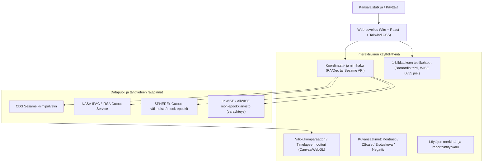
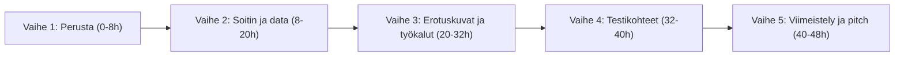

# PlanetXSPHEREx: Kansalaistieteen työkalu taivaankappaleiden liikkeen ja muuttuvuuden havaitsemiseen
## Projektisuunnitelma ja tekninen arkkitehtuuri (4 hengen tiimi)

---

### 1. Tiivistelmä ja haasteen tavoitteet

NASAn **SPHEREx**-missio (Spectro-Photometer for the History of the Universe, Epoch of Reionization, and Ices Explorer) kartoittaa koko taivaan kerran kuudessa kuukaudessa **102 lähi-infrapunan aallonpituuskaistalla** (0,75–5,0 µm).

**Haaste:** Rakentaa helppokäyttöinen, julkinen verkkotyökalu, jonka avulla kansalaistutkijat ja tähtitieteilijät voivat:
1. Syöttää taivaankoordinaatit (rektaskensio RA ja deklinaatio Dec joko asteina tai aikamuodossa) tai hakea kohteita suoraan nimellä.
2. Tarkastella kyseisen taivaankaistaleen kuvia eri havaintojaksoilta (epookeilta) aikasarja-animaationa / vilkkukomparaattorina ("blink comparator").
3. Havaita nopeasti liikkuvia kohteita (suuren ominaisliikkeen tähdet, ruskeat kääpiöt, asteroidit, komeetat, mahdollinen Planeetta Yhdeksän / Planet X) sekä kirkkauttaan muuttavia kohteita (muuttuvat tähdet, supernovat).
4. Testata ja validoida työkalun toimivuus viidellä pakollisella vertailukohteella:
   - **Barnardin tähti** (suurin tunnettu ominaisliike: $\sim 10,3''/\text{vuosi}$)
   - **Epsilon Indi B** (läheinen ruskeiden kääpiöiden kaksoisjärjestelmä tähden kiertoradalla)
   - **WISE 0855** (kylmin ja erittäin nopeasti liikkuva ruskea kääpiö: RA `08h55m10.831s`, Dec `-7d14m42.53s`)
   - **RW Aurigae** (purkautuva T Tauri -muuttuja)
   - **R Draconis** (Mira-tyypin sykkivä jättiläistähti)

---

### 2. Järjestelmäarkkitehtuuri ja datastrategia

#### Datanhallinta ja moniepookkistrategia
- **Koordinaatti- ja nimihaku:** Hyödynnetään **CDS Sesame Name Resolver** -rajapintaa (`https://cds.unistra.fr/cgi-bin/nph-sesame/-ox/SN?`), jotta käyttäjä voi hakea sekä tarkoilla koordinaateilla (`08h55m10.831s -07d14m42.53s` tai `133.795, -7.245`) että suoraan nimellä (esim. *"Barnard's Star"*).
- **SPHEREx- ja vertailudatan syöttö:**
  - SPHEREx tuottaa kokotaivaan kartan 6 kuukauden sykleissä.
  - Välittömän toimivuuden ja testikohteiden havainnollistamisen varmistamiseksi toteutetaan kaksitasoinen datalähde:
    1. **SPHEREx-rajapinta:** SPHERExin datajulkaisut ja kalibroidut esimerkkidatakuutiot.
    2. **Moniepookkinen infrapunasilta (unWISE / 2MASS / AllWISE):** IRSA-leikkausrajapinnan kautta saatavat todelliset infrapunakuvat useilta vuosilta, joiden avulla testikohteiden liike ja kirkkauden vaihtelut näkyvät konkreettisesti heti ensimmäisestä päivästä alkaen.
- **Kuvankäsittely suoraan selaimessa:**
  - Laitteistokiihdytetty HTML5 Canvas / WebGL -näkymä.
  - **Reaaliaikainen erotuskuva (Difference Imaging):** $\Delta I = \text{Kuva}_B - \text{Kuva}_A$. Kohteen siirtyminen synnyttää mustavalkoisen dipoliparin, jonka ihmisilmä havaitsee välittömästi.
  - Dynaamiset kontrastisäädöt: Lineaarinen, ZScale, Asinh, Logaritminen ja Negatiivitila (invertoitu mustavalkokuva on usein paras himmeiden kohteiden etsimiseen).

---

### 3. Tiimin roolit ja työnjako (4 hengen tiimi)

| Rooli | Päävastuut | Keskeiset tuotokset |
| :--- | :--- | :--- |
| **Henkilö 1: Frontend & UI/UX** | Web-sovelluksen arkkitehtuuri, responsiivinen ulkoasu, Canvas/WebGL-vilkkumoottori, toistosäätimet (FPS, pausaus, edestakainen bounce-toisto), tumma NASA-teema. | - Yhden sivun React-sovellus - Suorituskykyinen vilkkukomparaattori - Kontrasti-, zoomaus- ja panikointisäätimet - GIF / WebM -videovienti |
| **Henkilö 2: Astrofysiikka & Dataputki** | Koordinaattimuunnokset (sexagesimaali $\leftrightarrow$ desimaaliasteet), CDS Sesame -haku, FITS/kuvaleikkausten nouto, erotuskuva-algoritmi, SPHERExin 102 aallonpituuskaistan ryhmittely. | - Koordinaattien jäsennysmoduuli - IRSA/SPHEREx-rajapintaliitäntä - Kuvien kohdistus ja vähennyslaskenta - Aallonpituuskaistojen suodatus ja RGB-komposiitti |
| **Henkilö 3: Backend & Havaintojen raportointi** | Välimuistipalvelu kuvaleikkauksille, kansalaistieteen löytöjen kirjausjärjestelmä, havaintoraportin tallennus ja vienti. | - Nopea proxy-/välimuistirajapinta - Löytöjen merkintälomake (luokittelu & koordinaatit) - Tallennusjärjestelmä löydöille - Julkaisu pilveen (Vercel / Netlify / Railway) |
| **Henkilö 4: Tieteellinen laadunvarmistus & Pitchaus** | 5 testikohteen toiminnan varmistus, kansalaistutkijan kenttäoppaan (Field Guide) kirjoitus, dokumentaatio, esittelyvideo ja pitchaus-materiaali. | - Validoidut testitapaukset 5 pakolliselle kohteelle - Interaktiivinen kansalaistutkijan opas - Esityskalvot ja 3 minuutin demo-video - NASA Space Apps -projektisivun tekstit |

---

### 4. Vaiheittainen etenemissuunnitelma (48 h hackathon)

#### Vaihe 1: Alustus ja pohjatyö (Tunnit 0–8)
- [ ] Projektin alustus (Vite + React + TypeScript + Tailwind CSS).
- [ ] Koodauskäytännöt, hakemistorakenne ja automaattinen julkaisu (Vercel / GitHub Pages).
- [ ] Koordinaattimuuntimen toteutus (`parseSexagesimalToDeg`, `formatDegToSexagesimal`).
- [ ] CDS Sesame -rajapinnan integrointi (kohteiden automaattihaku nimellä).
- [ ] Esiasetettujen 5 testikohteen pikavalikko käyttöliittymään.

#### Vaihe 2: Kuvatiedonsiirto ja vilkkukomparaattori (Tunnit 8–20)
- [ ] Canvas-pohjainen animaatiosoitin:
  - Play / Pause, nopeudensäädin (1–15 kuvaa sekunnissa), kuva kerrallaan siirtyminen.
  - Toistotilat: Jatkuva silmukka (`A -> B -> C -> A`) ja edestakainen ping-pong (`A -> B -> C -> B -> A`).
- [ ] Moniepookkisen kuvahaun kytkentä:
  - Kuvien haku annettuihin $(RA, Dec)$ -koordinaatteihin.
  - Näkökentän (FOV) valinta (esim. $1', 2', 5', 10'$ kaariminuuttia).
- [ ] Tähtitieteellinen tähtäinristikko ja mittakaava (esim. $10''$ tai $1'$ jana).

#### Vaihe 3: Kuvankäsittely ja kansalaistutkijan työkalut (Tunnit 20–32)
- [ ] **Erotuskuvatila (Difference Imaging):** Lasketaan $(Epookki_2 - Epookki_1)$ pikseliero suoraan selaimessa.
- [ ] **Kontrasti- ja värisäädöt:**
  - Negatiivitila / värien kääntö.
  - Histogrammin venytys (ZScale / Asinh).
- [ ] **SPHEREx-kaistavalitsin:**
  - 102 aallonpituuskaistan ryhmittely loogisiin osiin (vesijäät 3,0 µm, CO/CO$_2$ 4,2–4,7 µm, jatkumo-infrapuna).
  - Kolmen eri kaistan yhdistäminen vääräväri-RGB-kuvaksi.
- [ ] **Löytöjen merkintätyökalu:**
  - Klikkaa kuvaa ja aseta merkintä (sovellus laskee pikselistä tarkan taivaankoordinaatin).
  - Luokitteluvaihtoehdot: *Liikkuva kappale (asteroidi/komeetta/ruskea kääpiö)*, *Muuttuva tähti*, *Dipoli*, *Häiriö/artefakti*.

#### Vaihe 4: Testikohteiden validointi ja kalibrointi (Tunnit 32–40)
- [ ] **Barnardin tähti:** Varmistetaan selkeä ominaisliikkeen siirtymä ($>10''/\text{vuosi}$) epookkien välillä.
- [ ] **WISE 0855** (`08h55m10.831s, -07d14m42.53s`): Todennetaan kylmän ruskean kääpiön nopea liike taustataivaan suhteen.
- [ ] **Epsilon Indi B:** Havaitaan kirkkaan päätähden vieressä liikkuva ruskeiden kääpiöiden pari.
- [ ] **RW Aurigae:** Todennetaan suuri kirkkauden pudotus ja vaihtelu (pölypilvien aiheuttamat pimennykset).
- [ ] **R Draconis:** Todennetaan Mira-tähden valtava sykkiminen minimin ja maksimin välillä.

#### Vaihe 5: Viimeistely, ohjeet, esittelyvideo ja palautus (Tunnit 40–48)
- [ ] Interaktiivinen **"Kenttäopas / Näin etsit"** -ohjemodaali:
  - Miltä liikkuva asteroidi tai tähti näyttää vilkutuksessa?
  - Miltä dipoli näyttää erotuskuvassa?
  - Miten erottaa tähden diffraktioviikset aidosta kohteesta?
- [ ] Tiedostovienti: Tallenna vilkutus animaatio-GIFinä tai vie havaintoraportti PNG/PDF-muodossa.
- [ ] 3 minuutin nasevan esittelyvideon nauhoitus.
- [ ] README:n ja NASA Space Apps -projektisivun viimeistely.

---

### 5. Testikohteiden kalibrointitaulukko

| Kohde | RA (J2000) | Dec (J2000) | Tyyppi / Ilmiö | Mitä kansalaistutkija näkee |
| :--- | :--- | :--- | :--- | :--- |
| **Barnardin tähti** | `17h 57m 48.5s` | `+04° 41′ 36″` | Suuren ominaisliikkeen punainen kääpiö | Liikkuu $>10''$ vuodessa; huomattava loikka kuvaruudussa |
| **WISE 0855-0714** | `08h 55m 10.83s` | `-07° 14′ 42.5″` | Kylmin tunnettu aliruskea kääpiö | Himmeä pistemäinen lähde liikkuu nopeasti staattisten taustatähtien ohi |
| **Epsilon Indi B** | `22h 04m 10.5s` | `-56° 46′ 58″` | Ruskea kääpiöpari ($T1 + T6$) | Himmeä seuralaispari, jolla on sama ominaisliike päätähden kanssa |
| **RW Aurigae** | `05h 07m 49.5s` | `+30° 24′ 05″` | Nuori purkautuva T Tauri -tähti | Rajuja kirkkauden muutoksia epookkien välillä ympäröivän pölyn takia |
| **R Draconis** | `16h 32m 40.2s` | `+66° 45′ 18″` | Mira-tyypin sykkivä punainen jättiläinen | Jakso $\approx 245$ päivää; kirkkaus vaihtelee magnitudien 6,7 ja 13,2 välillä |

---

### 6. Suositeltu teknologiapino

- **Käyttöliittymä:** React 18 / Next.js + TypeScript
- **Tyylit:** Tailwind CSS + Lucide Icons (avaruusteemainen tumma UI)
- **Animaatio ja grafiikka:** HTML5 2D Canvas tai Pixi.js (nopea pikselitason laskenta erotuskuville)
- **Tähtitieteen työkalut:** CDS Sesame (nimipalvelin), NASA/IPAC IRSA Cutout API, unWISE-arkisto
- **Vienti:** `gifshot` tai `canvas-capture` (selaimessa generoituva GIF/WebM-animaatio)
- **Julkaisu:** Vercel tai GitHub Pages (ilmainen, välitön ja luotettava hosting)
